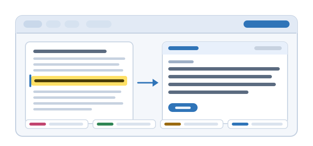
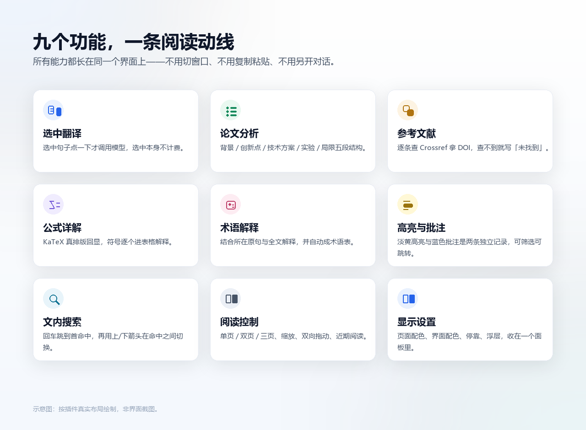
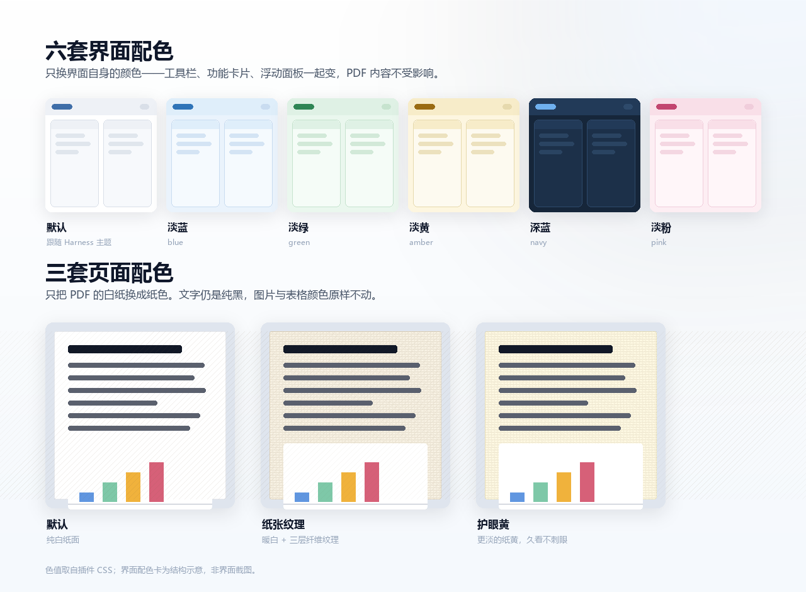
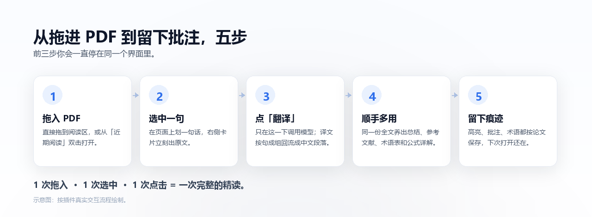
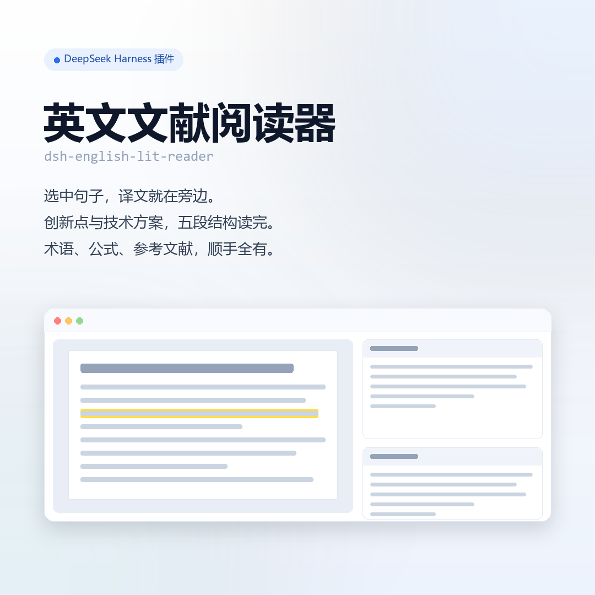

# dsh-english-lit-reader · 英文文献阅读器

**English** — A DeepSeek Harness plugin for reading English papers: drag in a PDF, select a sentence and get a translation beside it, generate a structured Chinese analysis of the paper's innovations and technical approach, resolve the bibliography, explain formulas and terms, highlight and annotate, and search inside the document. Everything runs inside the Harness Web GUI and uses whichever model the Harness is already configured with — no extra API key.

**中文** — 一个安装在 DeepSeek Harness 里的英文文献阅读插件：拖入 PDF、选中句子旁边出译文、按固定结构总结论文创新点与技术方案、自动整理参考文献并查地址、解释公式与专业术语、高亮批注、文内搜索。全部在 Harness 界面内完成，模型用的是 Harness 已经配好的那一个，不需要额外填 API key。



| 功能总览 | 配色一览 |
| --- | --- |
|  |  |

| 五步上手 | 方形预览 |
| --- | --- |
|  |  |

宣传文案（中英双语的短版 / 长版）与图片生成脚本见 [`promo/`](promo/)。

## 安装

要求 DSH 0.2.x（`dsh.bundle` 型插件）。

从源码安装（当前方式）：

```bash
git clone https://github.com/YuboCoco/dsh-english-lit-reader.git
cd dsh-english-lit-reader
```

这个包没有运行时依赖（pdf.js 与 KaTeX 已按发行版打包在 `vendor/` 里），不需要 `pnpm install`。

然后用 Harness 的插件管理器把该目录作为 bundle 装进 profile——`package.json` 已声明 `dsh.bundle.patch`，管理器会读取它。装好以后**重启 Harness**，会话页顶部会多出一个「文献阅读」标签页。

如果你把这类 link 安装换成版本安装：

```bash
# 在 DSH 的 profile 目录里
pnpm add github:YuboCoco/dsh-english-lit-reader
```

> npm 上暂未发布，所以暂时不能 `pnpm add dsh-english-lit-reader`，也不能在「设置 → 插件」里按名字搜索到。发布后这段会更新。

## 三个入口

1. 会话页顶部「对话 / 痕迹 / 上下文」那一行里的 **「文献阅读」标签页**（全宽视图）。
2. **左侧边栏工具栏**里的文件夹图标（中央面板打开）。
3. **右侧「开始」面板**里的「文献阅读器」入口（右栏内打开）。

三处共用同一份状态，在任一处打开的论文、译文、分析结果、页码都会在另外两处继续。

## 能做什么

- **选中翻译**：在 PDF 或纯文本中选中句子后，按住 Shift 再划选可追加一段原文，点击「翻译」一起生成译文。支持内联浮层（可拖动、可缩放、字号可调），选中文本会先做格式归一（去软连字符、行尾断词、单换行变空格）。
- **论文分析**：优先在所选模型的上下文预算内一次读取 PDF 全文，按「论文概览 / 研究问题与已有方法 / 技术方案 / 实验设置与结果 / 局限与适用范围 / 复现与可借鉴之处」生成详细报告。重点解释模型流程、训练与推理、关键公式、实验对照和消融结果，适合比较的数据用表格呈现。超过预算或全文直读失败时，完整分段提取笔记再汇总。汇总失败可点「仅重试汇总」复用已保存的笔记。结果按论文保存，并标注生成模型、推理强度和时间。
- **参考文献**：先按原文把文末目录切成一条条（保留原编号、页码和原文），**立刻显示**；随后逐批补中文标题，再逐条查地址。原文里印了 DOI / arXiv 号的直接给链并标「原文提供」，不去提问；其余走 Crossref / OpenAlex，并区分「已匹配」「无匹配」「待确认」「暂时失败」——查不到就写「未找到」，**不编造链接**，失败的可以一键重试。
- **插图图解**：在 PDF 工具栏点「插图解释」，拖动框住一页内的图表。「图解」使用框选图片和附近的图注或正文生成中文解读。每条解读按论文保存在浏览器中，显示图注、页码、生成模型、推理强度和本地时间，点页码可跳回原页。「排序」可按文中位置或分析时间正序、倒序排列。需要支持图像输入的 Harness 模型。
- **公式详解**：选中公式右键 →「解释公式」，弹出卡片用 KaTeX 真排版回显公式，按「公式含义 / 符号说明（表格）/ 在论文中的作用 / 计算与实现要点」详解。
- **术语解释**：选中单个词或短语右键 →「解释术语」，结合它所在的原句和论文全文解释，并自动收录进「术语解释」卡片。卡片停靠时，点击词条会在旁边打开带指向箭头的气泡。
- **高亮与批注**：右键添加，高亮是淡黄底 + 黑字，批注是蓝色虚线，两者是**独立的两条记录**，同一句话可以各有其一；列表可按「全部 / 仅高亮 / 仅批注」筛选，点条目跳回原文位置。
- **文内搜索**：工具栏搜索框，回车跳到第一个命中，▴ / ▾（或 Shift+回车）在命中之间切换并回绕。
- **阅读控制**：单页 / 双页 / 三页布局、缩放（含 Ctrl+滚轮）、双向拖动、近期阅读（PDF 字节存 IndexedDB，刷新后仍可双击直接打开）。点标题栏右侧的全屏按钮切换全屏，也可按 Esc 退出。
- **功能卡片**：点卡片标题展开或折叠。拖住标题旁的抓手可调整顺序，也可拖到页面上浮动，拖回功能栏时重新停靠。浮动时拖动边缘或角落可调整大小，位置和尺寸会保存。底部停靠时标题位于左侧，折叠后收成左侧标题条。功能栏标题旁可切换停靠，齿轮菜单可管理卡片和恢复默认布局。
- **外观**：「显示设置」中的界面配色可跟随 Harness，或选用四套浅色与五套深色主题。页面配色可选择默认、纸张纹理、护眼黄、柔白、雾蓝、浅青绿和细麻纹。纸张外的阅读区背景由界面配色决定。

## 实现要点

```
dsh-english-lit-reader/
├── package.json        # exports "." / "./client" / "./locale/*.json" / "./icon" / "./vendor/*"
├── cordis.patch.yml    # insert: english-lit-reader → dsh-english-lit-reader
├── index.js            # Host：HTTP 路由 + llm.stream + 分段 / Map-Reduce / 公式 / 术语
├── client.js           # Client：conversation.view + sidebar.panellist/main + 右栏 guide
├── paper-planning.js   # 客户端与 Host 共用的参考文献分批与分页工具
├── paper-analysis.js   # 全文预算、完整分段和分析汇总
├── icon.svg
├── locale/en.json · zh.json
├── docs/DETAIL.md      # 插件详情页
└── vendor/             # pdf.js 3.11.174（UMD + viewer）+ KaTeX 0.16.9
```

- **Host（`index.js`）** 调度 `llm.stream()`、保存框选图片附件并提供静态文件。所有路由用 `webServer.register` 注册并校验来源。路由前缀 `/plugins/english-lit-reader/` 下提供 `meta`、`models`、`efforts`、`translate`、`summary`、`references`、`formula`、`term`、`figure`、`paper-planning.js` 和 `vendor/*`。`summary/analyze` 也使用同一分析实现。
- **Client（`client.js`）** 通过 `window.__ModuleLoader__.load({id, factory})` 注册，5 个槽位：`conversation.view`（`order: 20`，排在 Chat 之后、上下文之前）、`sidebar.panellist` + `main`（左侧入口与中央面板）、`sidebar.right.pane.tab` + `.title`（右侧「开始」入口）。
- **样式**默认跟随 Harness 明暗主题，可另选界面配色。PDF 纸张配色单独设置，只作用于纸面。
- **纸面配色的做法**：pdf.js 把整页白底**画进 canvas**，所以给 `.page` 加 `background-color`（哪怕 `!important`）完全看不见。这里是在画布之上、文字层之下叠两层 `mix-blend-mode: darken` 的层（不透明纸色 + 低透明度纹理），`darken` 逐通道取更暗的一方，于是纯黑文字、比纸色深的图表像素都原样返回，只把白底换成纸色。

## 已知限制

- 扫描版 PDF（纯图片、无文字层）无法选中文本，因此选中翻译、搜索、公式 / 术语解释都用不了。
- 模型输出速度随输入长度超线性增长：选中翻译按句子成组、以 2400 字符为一个调用单元切分；只提供 `high` 档的慢推理模型在长段落上容易接近 120 s 单段超时，未显式选过模型时会自动挑一个 flash 类模型。
- PDF 字节存在浏览器 IndexedDB（单文件上限 60 MB），隐私模式或被禁用时不影响当前阅读，但刷新后需重新选文件。
- 参考文献依赖 Crossref / OpenAlex 的元数据。这两个服务对匿名请求限流（Crossref 每秒 3 次），所以条目多时地址阶段会明显变慢；限流或超时归入「暂时失败」，与「确实没有 DOI」分开显示，可用「重试失败项」重跑。冷门条目、预印本镜像会显示「待确认」或「未找到」，而不是猜一个链接。

## 许可

MIT。见 [LICENSE](LICENSE)。

## 第三方组件

- [pdf.js](https://github.com/mozilla/pdf.js) 3.11.174 — Apache-2.0，见 `vendor/PDFJS-LICENSE`。
- [KaTeX](https://github.com/KaTeX/KaTeX) 0.16.9 — MIT，见 `vendor/katex/KATEX-LICENSE`。

两者都以未修改的发行版形式随插件打包（pdf.js 的 viewer 有一处缓存页数常量调整，见源码注释），不依赖任何 CDN。

## 更新记录

见 [CHANGELOG.md](CHANGELOG.md)。
